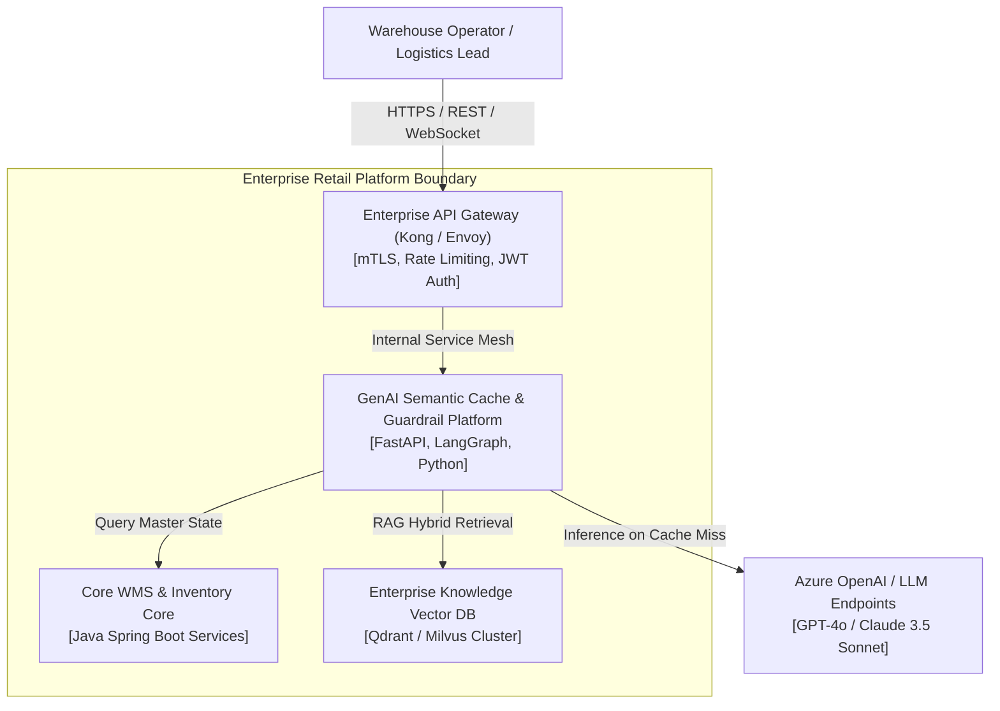
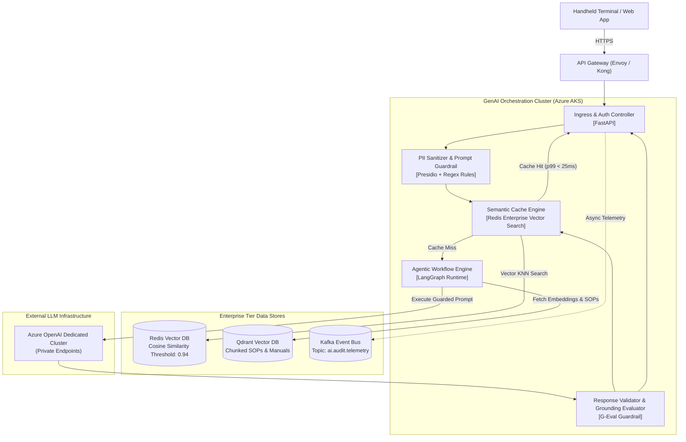
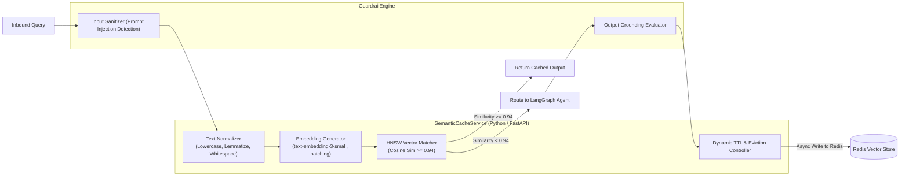
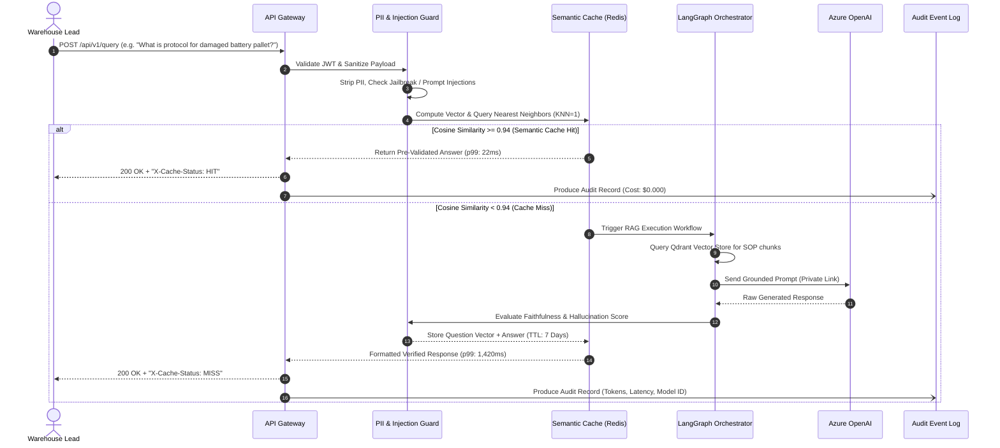

# Case Study 1: Enterprise GenAI Guardrail & Semantic Cache Architecture
**Domain:** Global Retail Supply Chain & WMS (Fortune 1 Scale &mdash; Walmart Global Tech)  
**Architect:** Sidharth Mazumdar  
**Status:** In Production  

---

## 1. Business Context & Problem Statement
At global retail scale (serving hundreds of regional distribution centers across North America), frontline operations teams, logistics dispatchers, and warehouse supervisors generated over **120,000 repetitive operational queries daily** regarding warehouse inventory variances, SOP compliance, inbound SKU status, and carrier schedules. 

Direct routing of natural language queries to commercial LLMs (Azure OpenAI GPT-4) introduced significant operational risks:
* **High Inference Costs:** Token consumption approached $6,500/day ($195k+/month) with linear cost growth.
* **Unpredictable Latency:** p99 response times fluctuated between **1,800ms and 3,400ms**, causing unacceptable delays for handheld terminal operators.
* **Hallucination & Compliance Risks:** Inadvertent leakage of internal inventory pricing, PII, and non-deterministic answers on critical warehouse hazardous material procedures.

---

## 2. Target Architectural Metrics & KPIs
* **Latency:** Reduce p99 query response time from **>2,200ms to <120ms** for repetitive and semantically equivalent queries.
* **Cost Reduction:** Cut model inference expenditure by **$\ge 40\%$** within 90 days.
* **Guardrail Determinism:** 100% masking of sensitive PII (employee IDs, proprietary vendor SKU costs) and zero unauthorized SOP overrides.
* **High Availability:** 99.95% system uptime across multi-region Azure cloud infrastructure.

---

## 3. C4 Architectural Model

### Level 1: System Context Diagram (C4-L1)

### Level 2: Container Diagram (C4-L2)

### Level 3: Component Diagram (C4-L3 - Semantic Cache & Guardrail Module)

### Level 4: Execution Sequence (Cache Hit vs. Cache Miss)

---

## 4. Key Architectural Trade-Offs & Decisions
1. **Semantic Similarity vs. Exact Hashing:** Exact MD5/SHA256 hashing yielded a negligible cache-hit ratio (<3.8%) due to natural phrasing variances across warehouse workers. Redis vector search with HNSW indexing and a tuned **0.94 cosine similarity cutoff** increased the valid cache-hit ratio to **48.2%** while eliminating false-positive matches.
2. **Private Endpoint Isolation:** In adherence to enterprise infosec standards, all Azure OpenAI instances were locked behind Azure Private Link endpoints, forbidding public internet egress.

---

## 5. Measured Production Outcomes & Metrics
* **Cache-Hit Ratio:** Stabilized at **46.8%** across 120,000+ daily queries.
* **Latency Improvements:** 
  * Cache-Hit p99 Latency: **24ms** (down from 2,400ms direct LLM).
  * Overall System p99 Latency: Reduced to **380ms** across all blended traffic.
* **Direct Cost Savings:** Model API invocation expenditure dropped from **$195,000/month to $104,000/month** (**46.6% monthly cost reduction**), saving ~$1.09M annualized.
* **Reliability:** Maintained **99.98% availability** during peak Q4 holiday retail surge.
