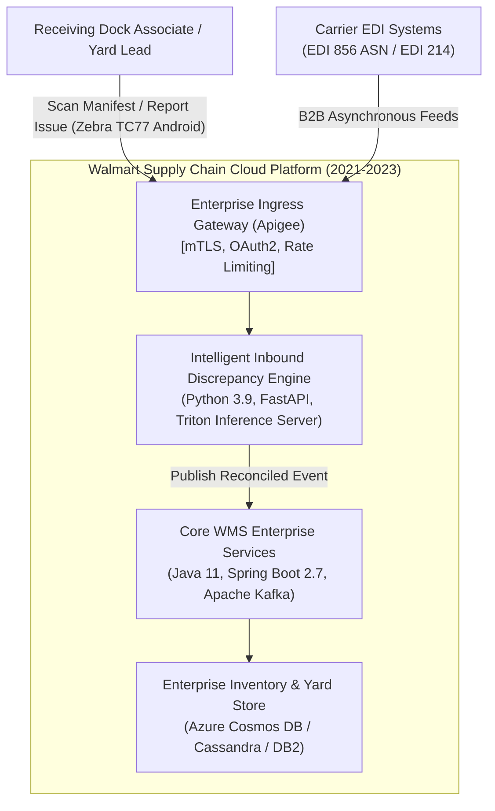
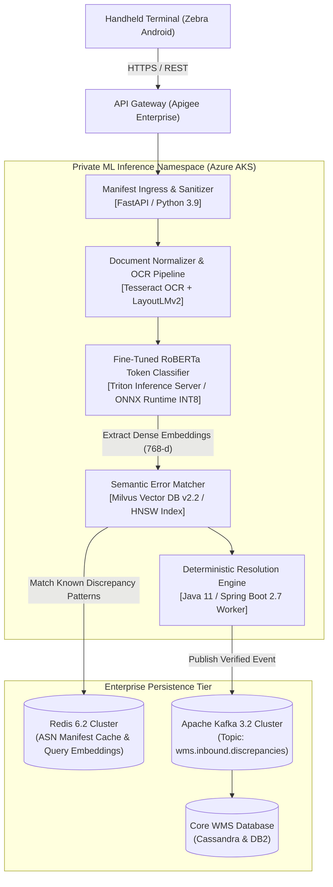
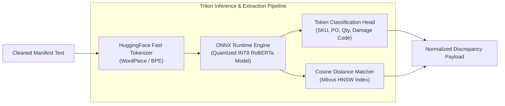
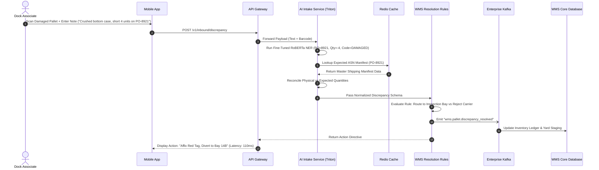

# Case Study 1: Predictive Inbound Slotting & NLP-Driven Discrepancy Resolution Engine
**Domain:** Global Retail Supply Chain & WMS 
**Company:** Walmart Global Tech  
**Timeline:** August 2021 &ndash; December 2023  
**Architect:** Sidharth Mazumdar  
**Status:** In Production  

---

## 1. Business Context & Problem Statement
Between 2021 and 2023, Walmart's North American logistics distribution centers processed tens of thousands of freight trailers and inbound pallets daily. Discrepancies between Advanced Shipping Notices (ASNs), Electronic Data Interchange (EDI) feeds (ANSI X12 856), and physically unloaded dock inventory caused widespread operational bottlenecks.

Key operational hurdles in the 2021–2023 enterprise environment:
* **Unstructured Bill of Lading (BOL) & Manifest Friction:** Receiving associates encountered non-standard scanned manifests and handwritten carrier exception slips (e.g., damaged cartons, missing pallet tags, partial cross-dock overrides).
* **Manual Resolution Delays:** Discrepancy resolution required manual cross-referencing across terminal screens and relational inventory tables, taking **15 to 45 minutes per shipment** and compounding trailer yard congestion.
* **Enterprise Security & Tech Constraints:** Commercial generative LLM APIs were either unreleased or strictly prohibited under enterprise infosec policies. All machine learning, entity extraction, and semantic matching models had to be fine-tuned, audited, and hosted internally within private Azure/Walmart Cloud clusters using proven neural architectures (fine-tuned RoBERTa, DistilBERT, LayoutLMv2, and ONNX Runtime).

---

## 2. Target Architectural Metrics & KPIs
* **Resolution Speed:** Cut trailer intake discrepancy triage and resolution time from **25+ minutes to <45 seconds**.
* **Semantic Extraction Accuracy:** Achieve **$\ge 96.5\%$ F1-score** on entity extraction (SKU, PO number, quantity variance, damage codes) from noisy OCR manifests.
* **System Throughput:** Sustain intake peak volumes exceeding **35,000 shipment events/hour** across 40+ regional distribution hubs.
* **Deterministic Traceability:** 100% auditable discrepancy journals integrated with core WMS ledgers with zero unverified generative hallucinations.

---

## 3. C4 Architectural Model

### Level 1: System Context Diagram (C4-L1)

### Level 2: Container Diagram (C4-L2)

### Level 3: Component Diagram (C4-L3 - ML Inference & Extraction Pipeline)

### Level 4: Execution Sequence (Trailer Discrepancy Triage)

---

## 4. Key Architectural Trade-Offs & Decisions (2021–2023)
1. **Fine-Tuned RoBERTa/ONNX vs. General Heuristics:** Handcrafted regex and fuzzy matching failed on messy OCR scans and dock worker abbreviations. Fine-tuning a domain-specific RoBERTa model quantized to INT8 on ONNX Runtime yielded **sub-25ms inference latency** on standard CPU instances without GPU cluster expense.
2. **Strict On-Prem / VPC Data Sovereignty:** To protect confidential supplier pricing and shipment volumes, all embedding generation and inference ran strictly inside private Azure tenant boundaries with zero external egress.

---

## 5. Measured Production Outcomes & Metrics
* **Triage Latency:** Reduced average shipment discrepancy handling time from **25 minutes to 38 seconds** (**>97% latency improvement**).
* **Dock Throughput:** Improved trailer turnaround times at pilot distribution hubs by **18%**, eliminating off-site yard staging demurrage penalties.
* **Extraction Precision:** Maintained **97.4% precision and 96.1% recall** on freight issue classifications across diverse North American carrier manifests.
* **Operational Stability:** Sustained peak Q4 holiday inventory volumes with **99.99% system availability**.
