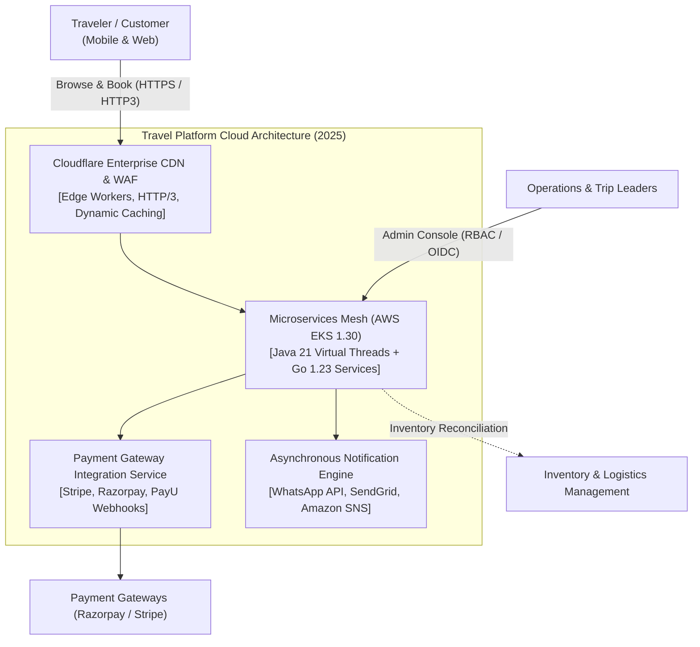
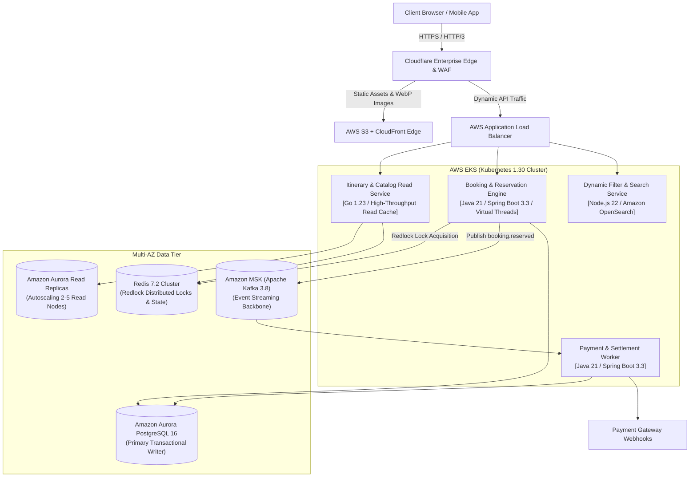
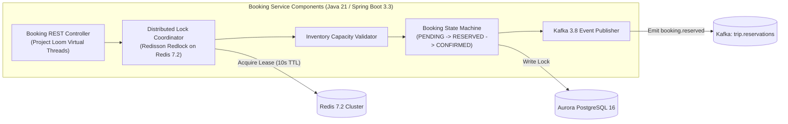
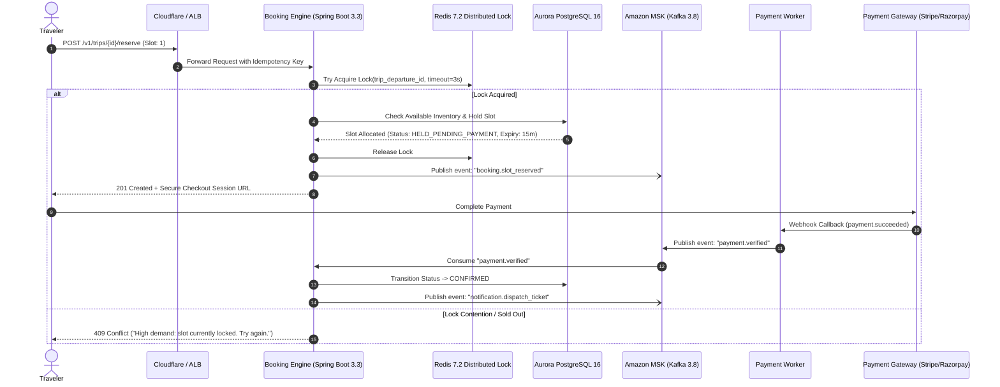

# Case Study 2: Full-Stack Cloud Architecture & Distributed Booking Engine Overhaul
**Client:** High-Growth Experiential Travel Company (Leading Adventure & Group Travel Platform)  
**Engineering Firm:** Quaapton AI Solutions Pvt. Ltd.  
**Timeline:** Calendar Year 2025  
**Role:** Co-Founder & Chief Technology Officer (CTO)  
**Status:** In Production  

---

## 1. Business Context & Problem Statement
In 2025, the experiential travel company expanded operations across multi-country group expeditions, dynamic seasonal campaigns, and multi-currency payment splits. The existing monolithic backend, originally hosted on legacy virtual servers, could no longer handle explosive mobile traffic.

Critical technical bottlenecks identified in early 2025:
* **Monolithic Thread Exhaustion:** Standard thread-per-request architectures on legacy runtimes locked up during synchronized promotional flash sales, producing cascading HTTP 504 Gateway Timeouts.
* **Inventory Race Conditions & Overbooking:** High concurrency on limited-capacity expeditions (e.g., Arctic tours, specialized treks) caused database record locking and double-bookings.
* **Slow Edge Asset Delivery:** Heavy media catalogs resulted in mobile First Contentful Paint (FCP) exceeding **3.8 seconds**, hurting marketing conversion rates.

---

## 2. Target Architectural Metrics & KPIs
* **Core Web Vitals:** Reduce FCP from **3.8s to <1.0s**; sub-1.5s total page load globally.
* **Concurrency & Scale:** Support **30,000 concurrent active users** and **1,800 checkout requests/minute** during flash sales without service degradation.
* **Zero Overbooking Guarantee:** Eliminate booking concurrency race conditions using distributed locking and asynchronous reservation queues.
* **Resilience:** Multi-AZ AWS EKS deployment achieving 99.98% availability with automated container recovery.

---

## 3. C4 Architectural Model

### Level 1: System Context Diagram (C4-L1)

### Level 2: Container Diagram (C4-L2)

### Level 3: Component Diagram (C4-L3 - Booking Engine & Distributed Lock)

### Level 4: Execution Sequence (Concurrent Booking & Settlement Flow)

---

## 4. Key Architectural Trade-Offs & Decisions (2025)
1. **Java 21 Virtual Threads (Project Loom) vs. Reactive WebFlux:** Rather than rewriting services to reactive patterns (which introduces debugging overhead and stack trace loss), adopting Java 21 Virtual Threads on Spring Boot 3.3 allowed writing clean imperative code while scaling to **10,000+ concurrent requests per node** with near-zero memory footprint.
2. **CQRS with Read Replicas & Edge Caching:** Completely decoupled browse/search paths from checkout transactions. Read routes are served directly via Cloudflare edge workers, Redis caches, and Aurora read replicas, protecting writer DB capacity during flash campaigns.

---

## 5. Measured Production Outcomes & Metrics
* **Page Load Speed:** Average mobile page load decreased from **5.2s to 1.4s**; Google Lighthouse performance score improved from **41 to 94**.
* **Traffic Resilience:** Successfully supported flash marketing campaigns with **32,000 concurrent users** and **1,850 API requests/second** with **0% downtime**.
* **Overbooking Elimination:** Reduced booking race conditions and overbooking errors to **absolute zero (0%)**.
* **Conversion Impact:** Checkout drop-off decreased by **34%**, contributing to a **28% net booking increase across the first two quarters of 2025**.
