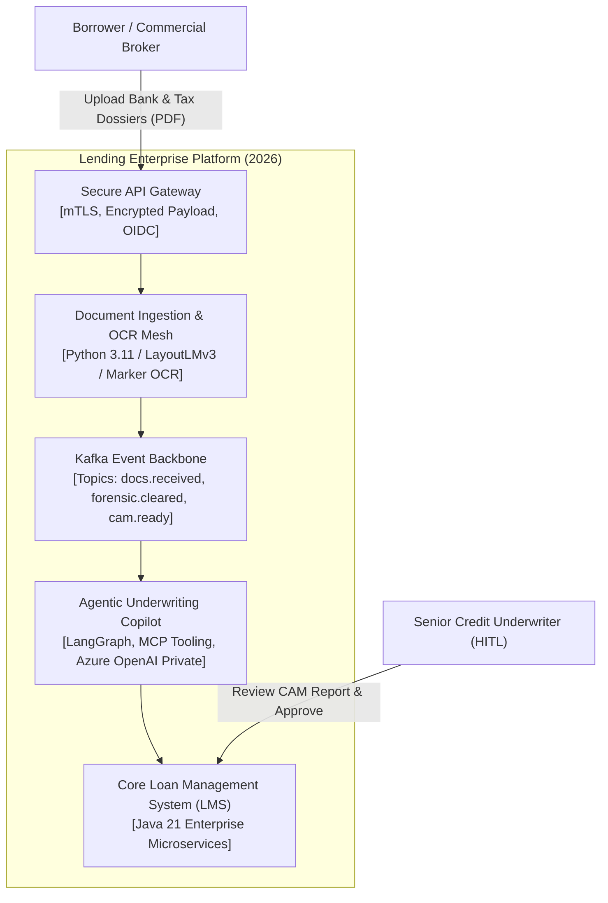
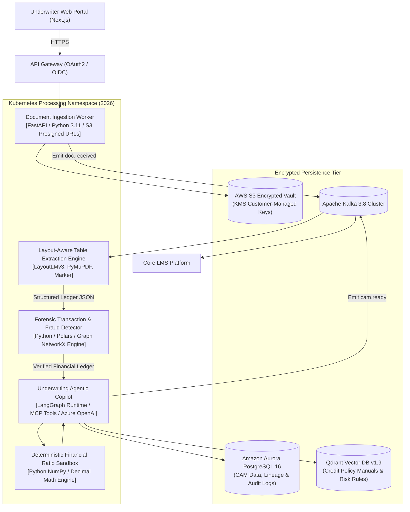
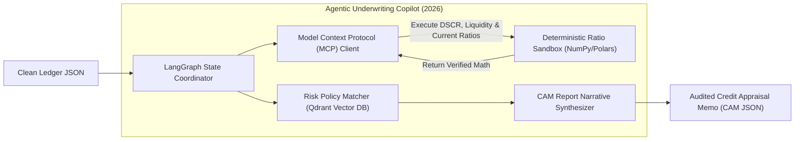
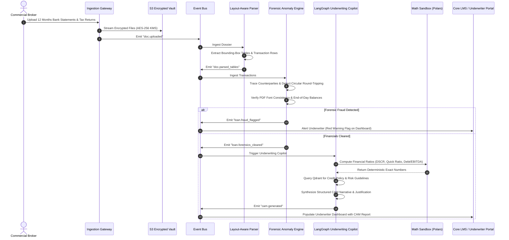

# Case Study 3: Event-Driven AI Credit Underwriting & Forensic Document Verification Copilot
**Domain:** Fintech / Commercial Lending & SME Credit  
**Engineering Firm:** Quaapton AI Solutions Pvt. Ltd.  
**Timeline:** 2026  
**Role:** Co-Founder & Chief Technology Officer (CTO)  
**Status:** In Production  

---

## 1. Business Context & Problem Statement
In 2026, a mid-market digital lending enterprise managing commercial debt facilities and working capital loans faced operational scaling limits. Their credit risk team manually appraised complex borrowing dossiers—incorporating 12 months of multi-bank PDF statements, GST tax returns, MCA filings, and audited balance sheets.

Key challenges in the 2026 landscape:
* **Underwriting Latency:** Manual forensic appraisal took **48 to 72 hours per case**, leading to customer drop-off toward automated lenders.
* **Subtle Financial Fraud:** Manual checks routinely missed circular fund routing (round-tripping between related entities), inflated month-end balances, and tampered PDF metadata.
* **AI Hallucination & Compliance Governance:** Pure generative LLMs frequently hallucinated complex mathematical ratios (e.g., Debt Service Coverage Ratio - DSCR). Furthermore, strict banking regulations (BaFin / RBI guidelines) mandated deterministic auditability, explainable reasoning traces, and strict customer data privacy.

---

## 2. Target Architectural Metrics & KPIs
* **Turnaround Time (TAT):** Cut financial appraisal memo preparation from **48 hours to <15 minutes**.
* **Data Extraction Precision:** Achieve **$\ge 99.0\%$ precision** on irregular, multi-column bank tables and scanned tax ledgers.
* **Fraud Detection:** Detect 100% of circular fund transfers, balance tampering, and PDF metadata anomalies.
* **Regulatory Governance:** Enforce deterministic computation sandboxes for financial math and provide an auditable reasoning trail with mandatory Human-In-The-Loop (HITL) sign-off.

---

## 3. C4 Architectural Model

### Level 1: System Context Diagram (C4-L1)

### Level 2: Container Diagram (C4-L2)

### Level 3: Component Diagram (C4-L3 - Agentic Copilot & Ratio Sandbox)

### Level 4: Execution Sequence (Document Analysis & Verification Pipeline)

---

## 4. Key Architectural Trade-Offs & Decisions (2026)
1. **Model Context Protocol (MCP) & Sandbox vs. Pure LLM Calculations:** Commercial LLMs make arithmetic errors when computing complex corporate debt ratios. In this architecture, all arithmetic (DSCR, Current Ratio, Operating Cash Flows) is delegated via MCP tools to an isolated **deterministic Python sandbox**. The LLM receives verified mathematical outputs solely to synthesize qualitative risk narratives.
2. **Deterministic Data Privacy:** Private Azure OpenAI deployments were provisioned with enterprise zero-data-retention agreements, ensuring client financial filings are never utilized for model fine-tuning.

---

## 5. Measured Production Outcomes & Metrics
* **Appraisal TAT:** Average underwriting dossier preparation time dropped from **48 hours to 11 minutes** (**>95% time reduction**).
* **Extraction Precision:** Maintained **99.1% parsing accuracy** across 24 distinct banking statement and tax ledger formats.
* **Forensic Protection:** Uncovered **$3.2M in round-tripping and fraudulent transaction schemes** during the first two quarters of 2026 that had previously gone unnoticed in manual spot-checks.
* **Capacity Scaling:** Increased underwriter throughput by **4.5x**, allowing the lender to scale portfolio originations without adding operational headcount.
